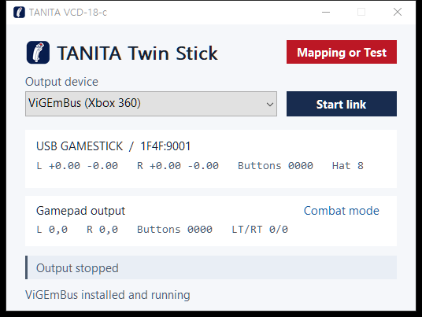
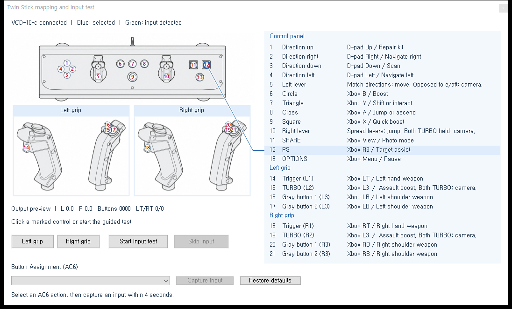
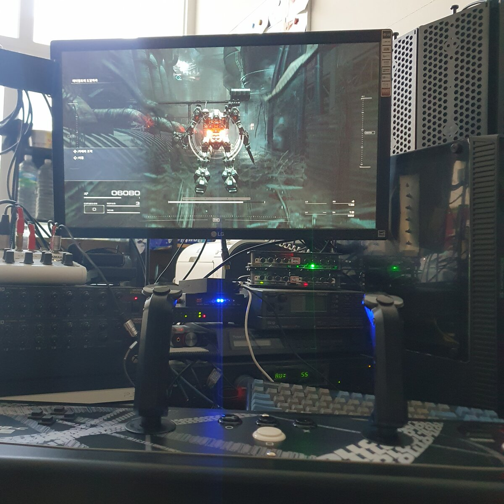

# TANITA Twin Stick Bridge

A native Windows x64 application that maps the TANITA VCD-18-c to a virtual gamepad for ARMORED CORE VI. It detects the physical controller by USB ID `1F4F:9001` and uses Win32 Raw Input to read the gamepad collection. The GUI shows physical input, the current control mode, and virtual output.

The app runs on Windows without Python, SDL, or a separate Visual C++ Redistributable. It targets Windows 10/11 x64 and was tested on Windows 10. Gamepad output requires the selected driver.

| Output | Status |
| --- | --- |
| ViGEmBus (Xbox 360) | Existing driver supported by the native app. The ViGEmBus output path has worked in AC6 on this PC with Steam Input enabled. |
| Custom HID driver | KMDF/VHF driver built and locally test-signed. Buttons and an axis were verified in Windows Game Controllers. AC6 reported an Easy Anti-Cheat DSE error with Windows test signing enabled, so in-game compatibility remains unverified. |

See [HOWTOUSE.md](HOWTOUSE.md) for setup, controls, AC TEST, and restoring normal boot after driver testing.

## Screenshots

### Main window



### Mapping and input test



### In game



The TANITA VCD-18-c Twin Stick driving an AC in ARMORED CORE VI through the bridge.

### Turning in place

AC6's Type A controller layout assigns movement to the left stick and camera control to the right stick. It has no independent input for turning the AC in place. Pushing one Twin Stick lever forward and the other backward therefore rotates the camera. [Official AC6 controller layout](https://www.fromsoftware.jp/manual/armoredcore6/win/operation.html)

## Project layout

| Path | Contents |
| --- | --- |
| [native/](native/) | Win32 application, C++ input mapper, and USB/HID diagnostic probe |
| [native/driver/](native/driver/) | Custom HID driver and its INF and build script |
| [legacy/](legacy/) | Original Python prototype lineage, calibrated configuration, example configuration, batch entry points, and tests |
| [docs/images/](docs/images/) | Screenshots and photos used in this README |
| `release/` | Local binaries, notices, and unsigned driver package generated by the build |

## Build from source

Run these commands from the repository root in the **x64 Native Tools Command Prompt for Visual Studio**. Install MSVC with Desktop development with C++ and the Windows SDK to build the app. Git is used to obtain the ViGEmClient source dependency.

```cmd
git clone https://github.com/nefarius/ViGEmClient.git "%TEMP%\TanitaViGEmSource"
git -C "%TEMP%\TanitaViGEmSource" checkout b66d02d57e32cc8595369c53418b843e958649b4
native\build-app.bat "%TEMP%\TanitaViGEmSource"
native\build-probe.bat
dumpbin /dependents release\Tanita.exe
```

If the ViGEmClient checkout already exists, skip the clone or pass its path directly. The app and ViGEmClient use static MSVC runtime linking (`/MT`). The scripts write `release\Tanita.exe`, `release\Probe.exe`, and the associated license notices. Object files go to `native\build\`.

For the custom driver, extract the [Microsoft.Windows.WDK.x64 10.0.26100.6584 NuGet package](https://www.nuget.org/packages/Microsoft.Windows.WDK.x64/10.0.26100.6584). Pass its extracted `c` directory to the driver build script.

```cmd
native\driver\build-driver.bat "C:\path\to\extracted-wdk\c"
```

The script checks the INF and writes `TanitaHid.sys`, `TanitaHid.inf`, and an unsigned `TanitaHid.cat` under `release\driver\`. The custom driver INF targets Windows 10 version 1709 (build 16299) or later on x64. Build artifacts are excluded from Git. See [native build notes](native/README.md) for driver signing and implementation details.

Run the legacy mapper tests from the repository root with `legacy\run_tests.bat`, or run `py -3 -B -m unittest discover -s tests -v` from `legacy\`.

## License

Project-owned source and documentation are licensed under **GPL-2.0-only**. See [LICENSE](LICENSE) for the full text. ViGEmClient is an external MIT-licensed build dependency. The separately installed ViGEmBus driver is BSD-3-Clause. [ViGEmClient license at the pinned revision](https://github.com/nefarius/ViGEmClient/blob/b66d02d57e32cc8595369c53418b843e958649b4/LICENSE) · [ViGEmBus license](https://github.com/nefarius/ViGEmBus/blob/master/LICENSE)

The repository distributes source. The `release/` folder is for local build output. Public binary distribution requires reviewing GPLv2 corresponding-source obligations and the applicable Microsoft terms for statically linked MSVC or WDK components. Keep the ViGEmClient notices and corresponding source with any applicable binary distribution. Obtain Microsoft build tools and the ViGEmBus installer separately. [GNU GPL FAQ](https://www.gnu.org/licenses/gpl-faq.html#WindowsRuntimeAndGPL) · [Visual Studio redistribution terms](https://learn.microsoft.com/en-us/visualstudio/releases/2026/redistribution)
